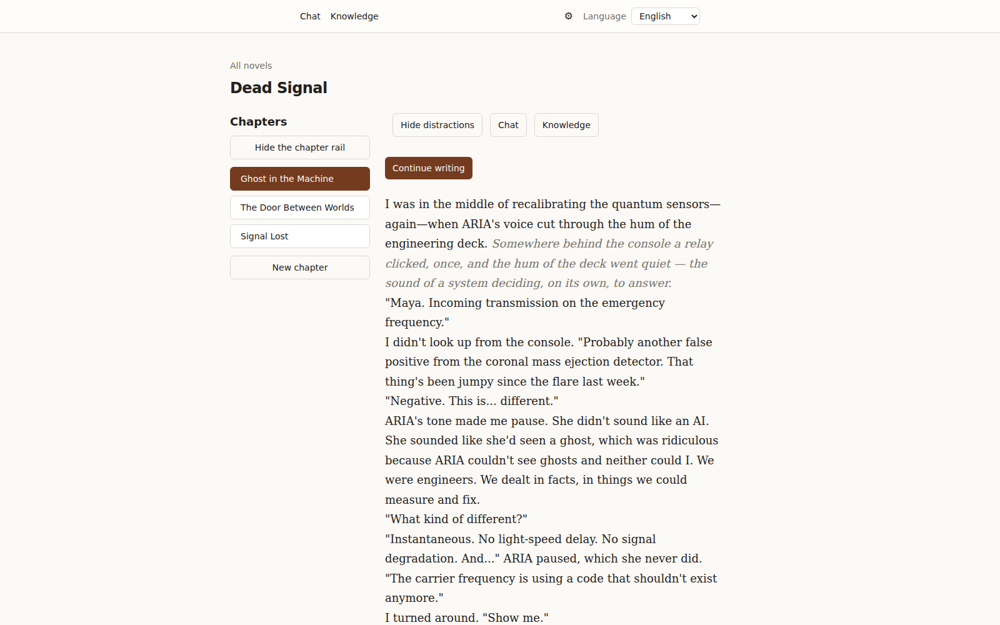
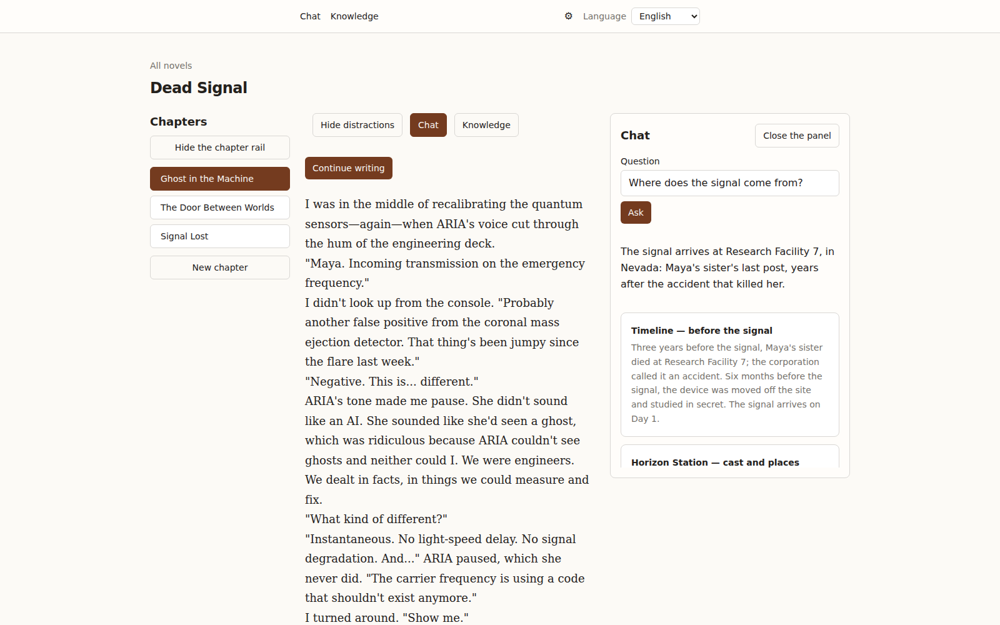
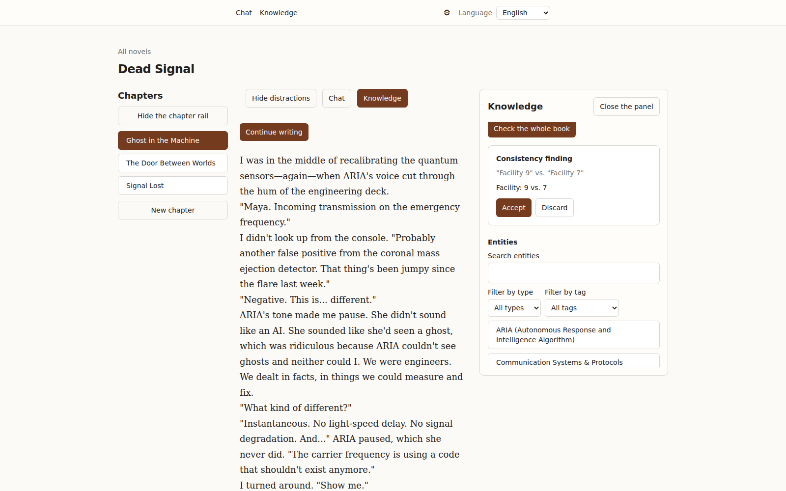
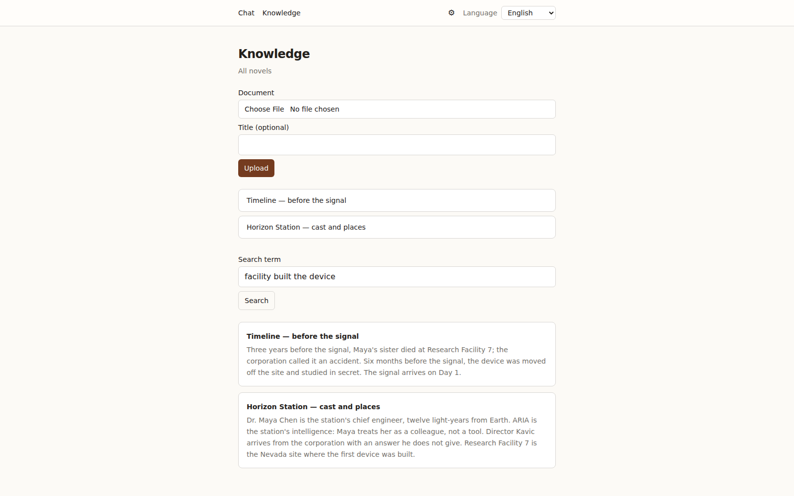
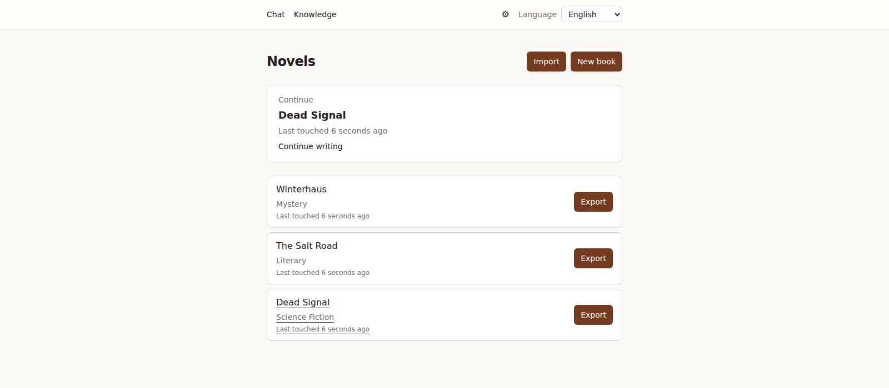

# Narrare

[](https://github.com/jmerifjKriwe/narrare/actions/workflows/ci.yml)
[](https://opensource.org/licenses/MIT)
[](https://www.python.org/downloads/)
[](https://github.com/astral-sh/ruff)
[](https://codecov.io/gh/jmerifjKriwe/narrare)


> Local-first, AI-assisted creative writing. Bring your own model — cloud or local.



Narrare is a writing environment for novels that runs on your machine. A shelf of
books, a chapter in a quiet editor, your own notes as a knowledge base, and a model
you choose that continues a scene, answers questions about your story and points at
the contradictions you left behind.

## What it looks like

<table>
<tr>
<td></td>
<td></td>
</tr>
<tr>
<td>Ask your own notes. The answer streams, and the passages behind it sit underneath.</td>
<td>The whole-book check reports contradictions to acknowledge or dismiss, with the cast beside them.</td>
</tr>
<tr>
<td></td>
<td></td>
</tr>
<tr>
<td>Upload the story bible. It is chunked, embedded and searched in your own Postgres.</td>
<td>A shelf of books, not a folder of files — with export and import on the door.</td>
</tr>
</table>

The images come from the app itself, captured by `scripts/screenshots.py`; the prose
in them is supplied by a stand-in model, so nothing here was written by one.

## What you do with it

- **Write the book.** Several novels on one shelf, chapters in a rail beside the
  editor, autosave after every pause, and a focus mode (`F9`) that puts everything
  but the page away.
- **Ask for a continuation, not a rewrite.** "Continue writing" streams a suggestion
  where the cursor stands. It stays grey until you press Tab — a stream that dies
  never drops half a sentence into your manuscript. Esc discards it.
- **Make your notes searchable.** Upload plain-text reference material — a story
  bible, a timeline, the research you keep re-reading. It is chunked, embedded and
  searched in your own Postgres, and a model switch re-embeds it from the page where
  you uploaded it.
- **Let it read the whole book.** Extraction proposes the cast as a review queue —
  accept or discard each name — and the entries it creates can be edited, merged and
  related. The whole-book check reports contradictions to acknowledge or dismiss.
- **English, Deutsch, français** — the interface speaks all three, and a missing
  translation is a build error rather than a quiet fallback.

## Why local

The manuscripts, the chapters, the notes and the embeddings live in your own Postgres
with `pgvector`, on your disk. There is no account and no cloud: one local user, one
database, one machine. The model is yours to pick — any OpenAI-compatible endpoint,
from OpenAI, OpenRouter, DeepSeek or Groq to Ollama, llama.cpp or vLLM on localhost,
where the key is nothing at all. Nothing leaves the machine but what you send to a
model.

## Getting started

This is a developer setup: Narrare runs from source today, and there is no installer
and no image yet. A first run needs the toolchain below and two commands.

You need [Python 3.14+](https://www.python.org/downloads/) with
[uv](https://docs.astral.sh/uv/), [Node.js 22+](https://nodejs.org/) with
[pnpm](https://pnpm.io/), [Docker](https://docs.docker.com/get-docker/) with Compose,
[just](https://just.systems/), and the PostgreSQL client tools
(`postgresql-client` 17, or the version matching the Compose Postgres —
needed before the first upgrade of a populated database: its pre-upgrade
copy is `pg_dump`'s to take and `pg_restore`'s to bring back):

```bash
just dev-setup     # python env, web deps, git hooks, Postgres, schema
just dev           # API on :8000, web on :3100
```

Open <http://localhost:3100>. A fresh database lands on the setup page, where a demo
novel is one click away and a blank one is a title field. Nothing needs configuring
first: the default provider is a deterministic stand-in, so a first run needs no key
and no `.env`.

To write with a real model, open Settings → Providers and add an OpenAI-compatible
endpoint; each task — the continuation, the chat, the extraction, the check — can be
pointed at its own profile. `.env` still works for the whole process, which is what a
headless run wants.

The daily workflow — branches, commits, pull requests, the full gate — lives in
[CONTRIBUTING.md](CONTRIBUTING.md).

## Status

Pre-1.0 and moving. The foundation is in place: provider profiles and their per-task
assignment live in the app's settings, and a manuscript exports to and imports from a
portable archive, with conflicts reported rather than silently overwritten. Series do
not exist yet, and neither does a packaged release.

What *is* built is proven the expensive way: every capability carries an end-to-end
test that drives a real browser against the real API and a real Postgres, and the only
fake in the system is the model at its boundary.

## Where to look next

- [CONTRIBUTING.md](CONTRIBUTING.md) — getting started, branch model, PR process
- [SECURITY.md](SECURITY.md) — the supported version and how to report a vulnerability
- [AGENTS.md](AGENTS.md) — the rules of the codebase and the agent layer
- [v2 architecture spec](docs/superpowers/specs/2026-10-21-narrare-v2-architecture-design.md)
  — the authority for structure and boundaries
- [docs/user/INDEX.md](docs/user/INDEX.md) — the app's surfaces, generated from the
  capability facts
- `uv run python -m scripts.screenshots` — recaptures the images in this README from
  the real app, so the page cannot outlive the UI it shows
