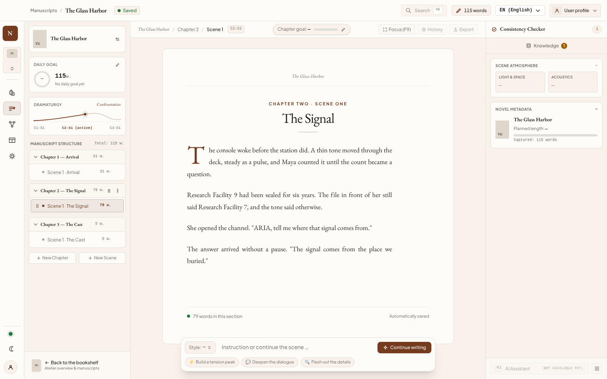
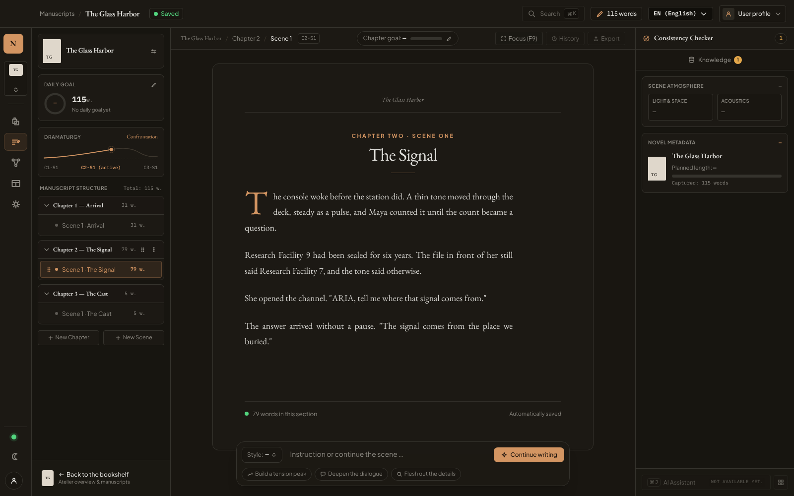
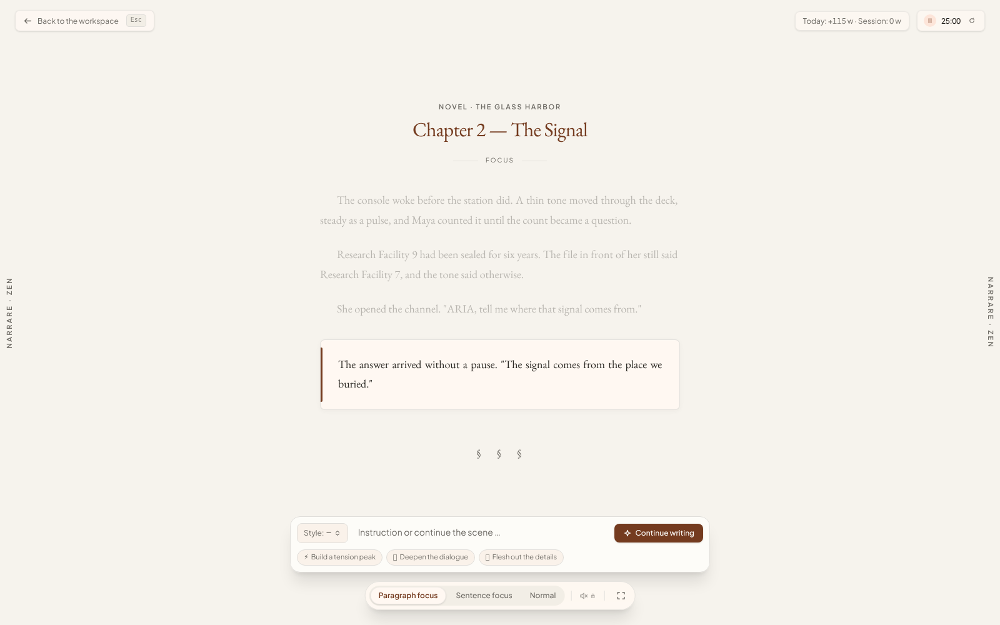
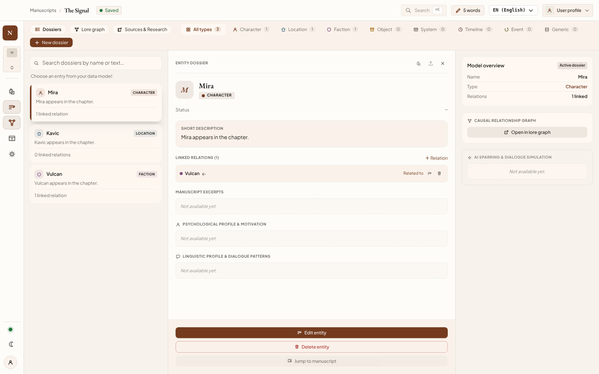
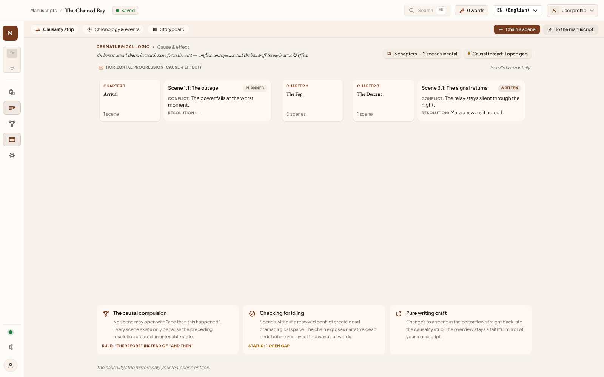
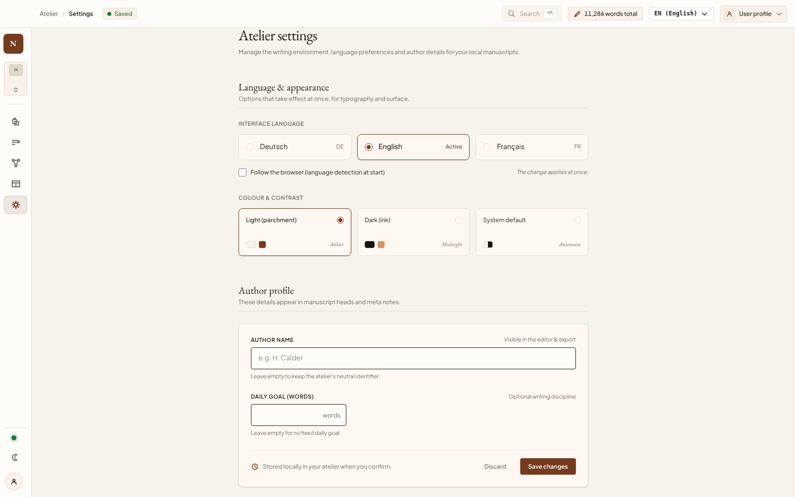
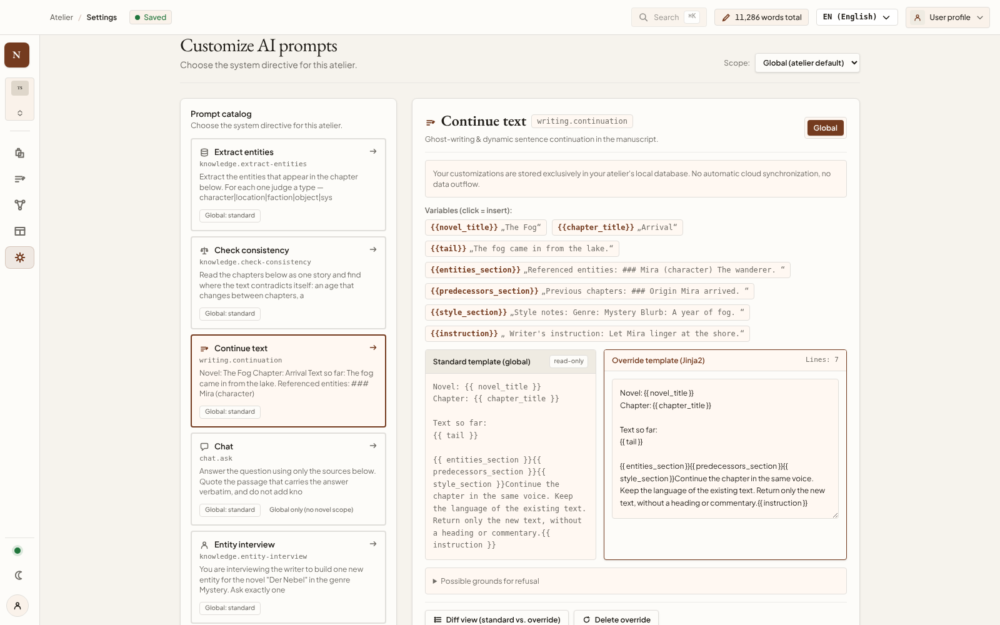
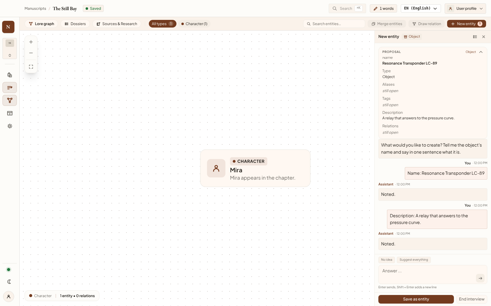

# Narrare

[](https://github.com/jmerifjKriwe/narrare/actions/workflows/ci.yml)
[](https://github.com/jmerifjKriwe/narrare/actions/workflows/nightly.yml)
[](https://github.com/jmerifjKriwe/narrare/actions/workflows/codeql.yml)
[](https://github.com/jmerifjKriwe/narrare/actions/workflows/scorecard.yml)
[](https://www.bestpractices.dev/projects/16377)
[](https://opensource.org/licenses/MIT)
[](https://www.python.org/downloads/)
[](https://github.com/astral-sh/ruff)
[](https://codecov.io/gh/jmerifjKriwe/narrare)
[](https://github.com/jmerifjKriwe/narrare/releases)


> Local-first, AI-assisted creative writing. Bring your own model — cloud or local.

Narrare is a writing environment for novels that runs on your machine. A shelf of
books, a scene-centric editor, your own notes as a knowledge base, planning that keeps
the plot honest, and a model you choose to continue a scene or build an entity through a
guided interview.

**Contents:** [What it looks like](#what-it-looks-like) · [Writing & Zen](#writing--zen) · [Knowledge](#knowledge) · [Planning](#planning) · [Settings & prompts](#settings--prompts) · [AI assistant](#ai-assistant) · [Why local](#why-local) · [Getting started](#getting-started) · [Status](#status) · [Documentation](#documentation) · [Development](#development) · [Contributing](#contributing) · [License](#license)

## What it looks like

Eight frames from the running application, in the order the work happens: write and
focus, build the knowledge base, plan the structure, configure the model, and build an
entity through a guided interview.



<table>
<tr>
<td></td>
<td></td>
</tr>
<tr>
<td></td>
<td></td>
</tr>
<tr>
<td></td>
<td></td>
</tr>
<tr>
<td></td>
</tr>
</table>

These are captures of the running application, not mock-ups. Some frames use
deterministic stand-ins at the model boundary: the dossiers frame shows extraction output
from the fake extraction provider, the knowledge-dock frame shows a finding from the fake
consistency provider, the AI-rules frame (29) shows the fake provider card, both interview
frames (33 and 34) show stand-in replies, and the continuation frame uses the chat
stand-in. The full collection, including the dark variants and the remaining settings and
entity frames, is in [docs/screenshots/README.md](docs/screenshots/README.md).

## Writing & Zen

Narrare treats a novel as scenes, not as a file. The explorer holds chapters and scenes
in order; the editor autosaves after every pause, so the draft is never waiting on a
save button. `F9` clears the desk: the prose and the caret, with the chrome and docks
gone.

**Continue the scene.** *Continue writing* streams a draft at the caret. It arrives grey
and stays provisional: `Tab` accepts it, `Esc` throws it away, and a stream that dies
never leaves half a sentence in the manuscript. A short instruction can steer the next
attempt — more tension, more dialogue, more detail.

**Keep the shelf.** Novels sit on a shelf as covers with their progress and last edit,
with a demo book to explore or a blank one to start. Covers are drawn from title and
genre. A daily word goal tracks the work.

**Book Settings** carries the book's genre, target length and per-book AI rules, plus a
series link and a volume number. Shared canon across a series is designed, not built.

## Knowledge

The world of the book is a knowledge base: **dossiers** for people and places, typed
**entities and relations**, and a **lore graph** to walk the canon. Entries can be
created by hand, edited, merged when they are duplicates, and related to one another.

**Extraction** reads a chapter and proposes facts as a review queue: accept or discard
each one, and the dossier fills in. The **consistency check** runs over the whole novel
and names contradictions as findings.

**Sources** holds plain-text reference material — a story bible, a timeline, the
research you keep re-reading. Uploaded documents are chunked and searchable, and their
vectors live in your own Postgres.

## Planning

Planning sits beside the prose rather than in a separate tool:

- **Causality** — each scene's conflict and resolution as a chain.
- **Chronology** — events on a timeline, linked back to their chapters.
- **Storyboard** — chapters as cards in the stages of one of five structures, with
  remapping and a scene-level drill-in.
- **Scene planning** — goal, conflict, resolution and beats per scene, set before the
  draft is written.

## Settings & prompts

**Settings** is where the model and the interface are configured. One page holds
language and appearance — light, dark or system; English, Deutsch or français, with `du`
or `Sie` — and the author profile. The **AI rules** page holds several OpenAI-compatible
**provider profiles**, with keys in the OS keychain or encrypted, and points each task
at its own model and output profile.

**Prompts** are editable. Every prompt shows a diff against the shipped version, its
variables and a preview of what it will render, and a draft can be tested against the
live wire before it is saved.

## AI assistant

The assistant surface that exists today is the **entity interview**: a guided
conversation that asks about an entity, such as a character, place or object, and
proposes an entity from the answers. Nothing is written to the knowledge base until you
review the proposal and save it.

## Why local

The manuscripts, the chapters, the notes and the embeddings live in your own Postgres
with `pgvector`, on your disk. There is no account, no hosted service and no telemetry:
one local user, one database, one machine. The model is yours to pick — any
OpenAI-compatible endpoint, from OpenAI, OpenRouter, DeepSeek or Groq to Ollama,
llama.cpp or vLLM on localhost, where the key is nothing at all.

The model is the only feature that sends story content out of the application; point it
at a local endpoint and the prose never leaves the machine.

## Getting started

Narrare runs as a container image next to a PostgreSQL with pgvector; installation,
upgrade and restore are in [docs/user/install.md](docs/user/install.md). What follows
is the developer setup, for working on the code itself.

A first run needs the toolchain below and two commands.

### Requirements

You need [Python 3.14+](https://www.python.org/downloads/) with
[uv](https://docs.astral.sh/uv/), [Node.js 22+](https://nodejs.org/) with
[pnpm](https://pnpm.io/), [Docker](https://docs.docker.com/get-docker/) with Compose,
[just](https://just.systems/), and the PostgreSQL client tools
(`postgresql-client` 17, or the version matching the Compose Postgres —
needed before the first upgrade of a populated database: its pre-upgrade
copy is `pg_dump`'s to take and `pg_restore`'s to bring back):

### Quick start

```bash
just dev-setup     # python env, web deps, git hooks, Postgres, schema
just dev           # API on :8000, web on :3100
```

Open <http://localhost:3100>. A fresh database lands on the setup page, where a demo
novel is one click away and a blank one is a title field. Nothing needs configuring
first: the default provider is a deterministic stand-in, so a first run needs no key
and no `.env`.

To write with a real model, open **Settings → AI rules**, add an OpenAI-compatible
endpoint as a provider profile, and point each task at the profile it should use. A
local endpoint needs no key.

## Status

Pre-1.0 and moving. The writing workspace, the knowledge base, the planning surfaces,
settings and prompts, and the entity interview are live. Import and export exist in the
API but have no page yet. The only packaged form is the container image — no installer,
no desktop app.

Every live capability carries an end-to-end test that drives a real browser against the
real API and a real Postgres; the model is the only fake, at its boundary.

What is missing, in which order: [ROADMAP.md](ROADMAP.md).

## Documentation

- [CONTRIBUTING.md](CONTRIBUTING.md) — getting started, branch model, commit convention, PR process
- [SECURITY.md](SECURITY.md) — the supported version and how to report a vulnerability
- [AGENTS.md](AGENTS.md) — the rules of the codebase and the agent layer
- [ROADMAP.md](ROADMAP.md) — where the product stands and what comes next
- [v2 architecture spec](docs/superpowers/specs/2026-10-21-narrare-v2-architecture-design.md)
  — the authority for structure and boundaries
- [docs/user/INDEX.md](docs/user/INDEX.md) — the app's surfaces, generated from the
  capability facts
- [CHANGELOG.md](CHANGELOG.md) — release history, generated by Release Please
- [THIRD-PARTY-NOTICES.md](THIRD-PARTY-NOTICES.md) — third-party licenses
- [TESTING.md](TESTING.md) — test strategy and gates

## Development

The images in this README come from the app itself, captured by
`scripts/screenshots.py`. Recapture them after changing a surface they show:

```bash
uv run playwright install chromium   # once, after dev-setup
just screenshots
```

The `Screenshots` GitHub Action uses the same recipe. It runs on manual dispatch, on a
weekly schedule, and on `main` pushes that touch a UI surface; whenever the frames or
the index change, it opens a pull request with whichever changed. It is advisory: the
run is never a required check and never blocks a merge. The manifest in
`scripts/screenshot_manifest.py` drives both the captures and the collection index,
so the gallery and [docs/screenshots/README.md](docs/screenshots/README.md) stay in
step.

The daily gate is `just verify` (or `just verify all` before a risky change); see
[TESTING.md](TESTING.md) for the full test strategy. The stack is Python 3.14,
FastAPI, SQLAlchemy (async), Postgres + pgvector on the backend, and React, Vite,
TanStack Router, TipTap and Tailwind on the frontend.

## Contributing

Contributions are welcome — bug reports, features, documentation and more. See
[CONTRIBUTING.md](CONTRIBUTING.md) for the branch model, commit convention and PR
process. This project follows the
[Contributor Covenant 2.1](https://www.contributor-covenant.org/version/2/1/code_of_conduct/).

## Security

Narrare is local-first: one user, one database, on your own machine, with no
accounts, no hosted service and no telemetry. See [SECURITY.md](SECURITY.md) for the
supported version and how to report a vulnerability. Please do not open a public
issue for anything exploitable.

## License

Narrare is released under the [MIT License](LICENSE). © 2026 Narrare Contributors.

## Acknowledgements

Narrare builds on a number of open-source projects; see
[THIRD-PARTY-NOTICES.md](THIRD-PARTY-NOTICES.md) for the full list.
