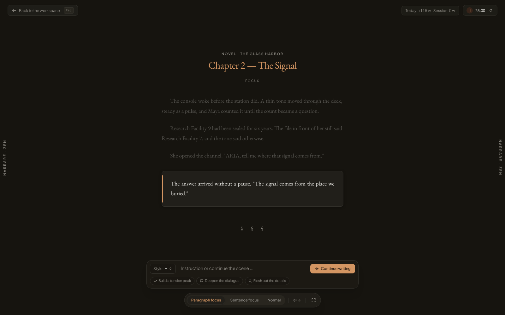
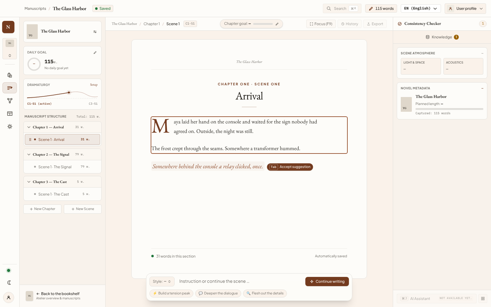
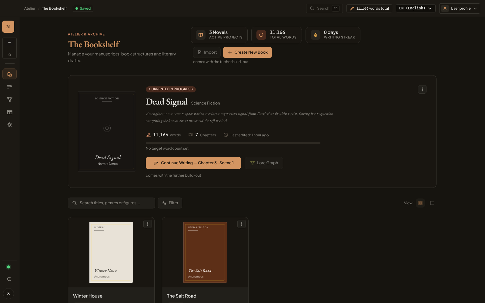
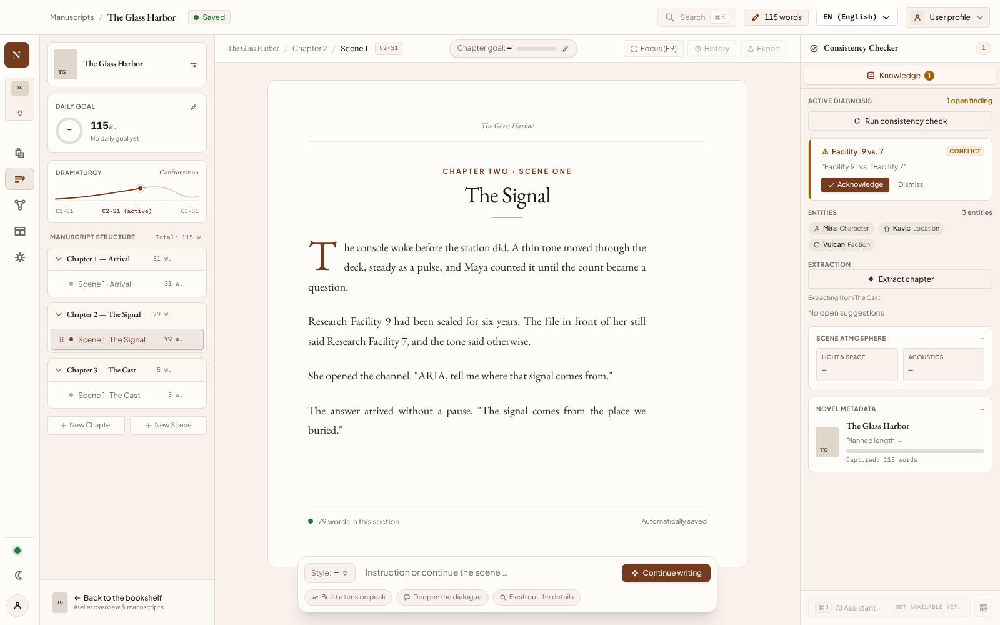
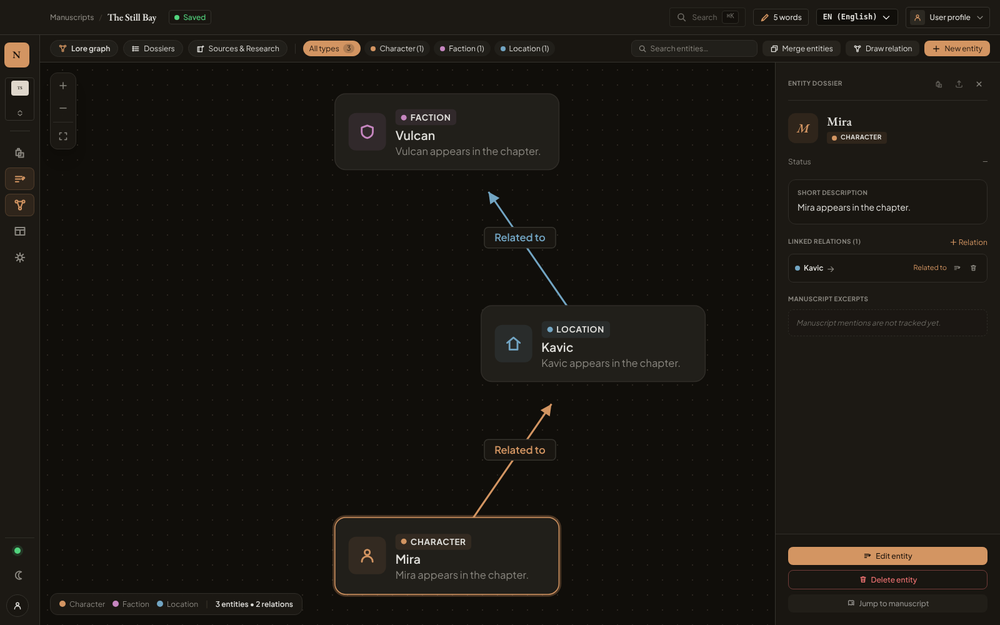
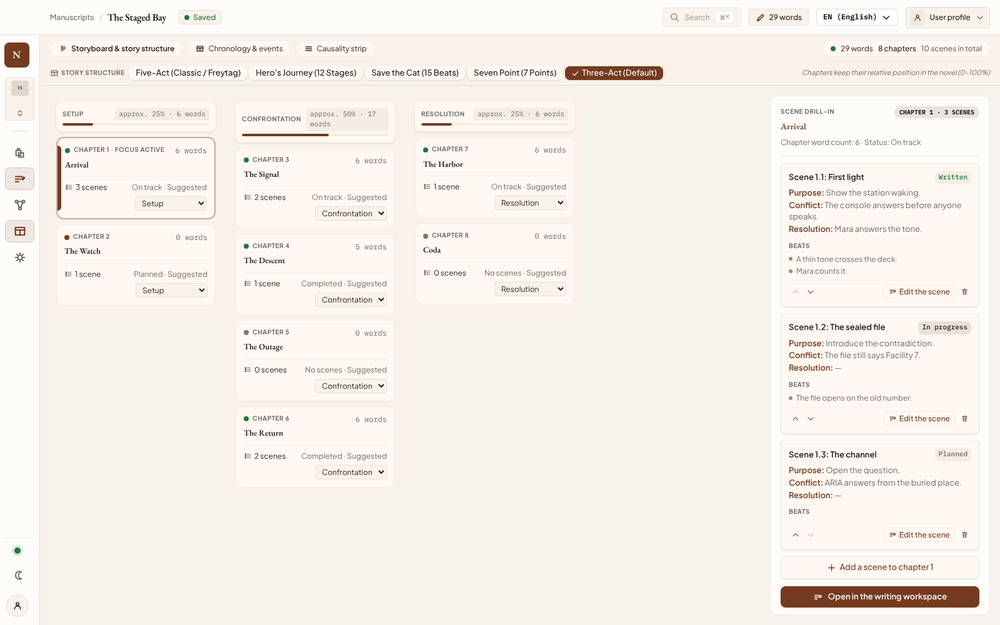
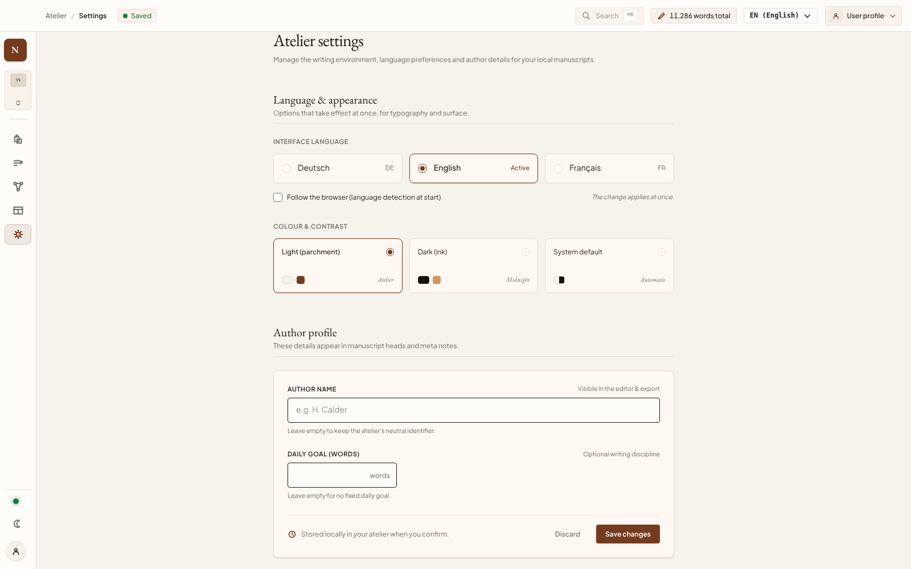
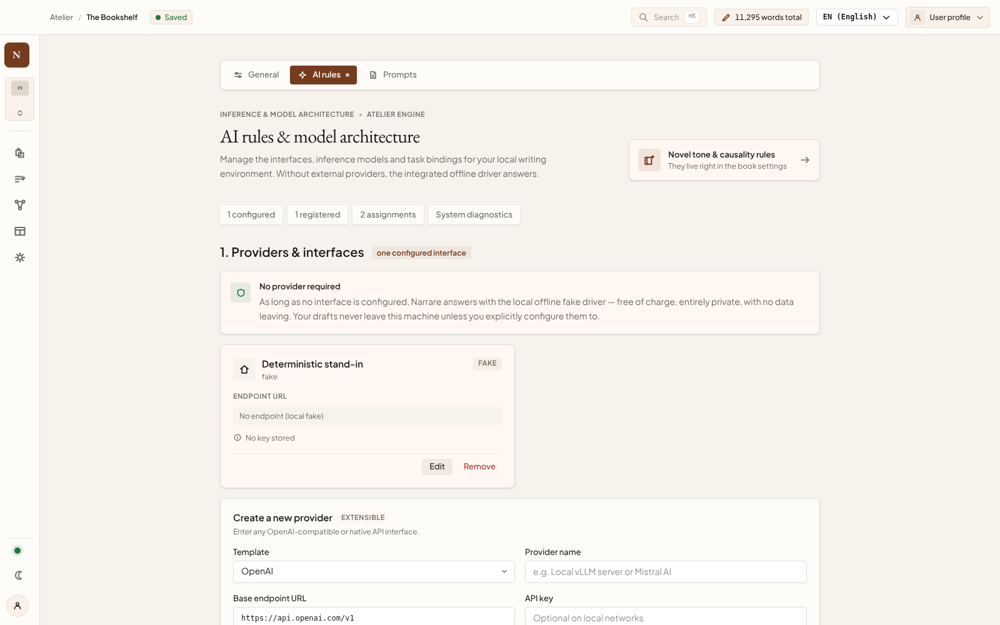
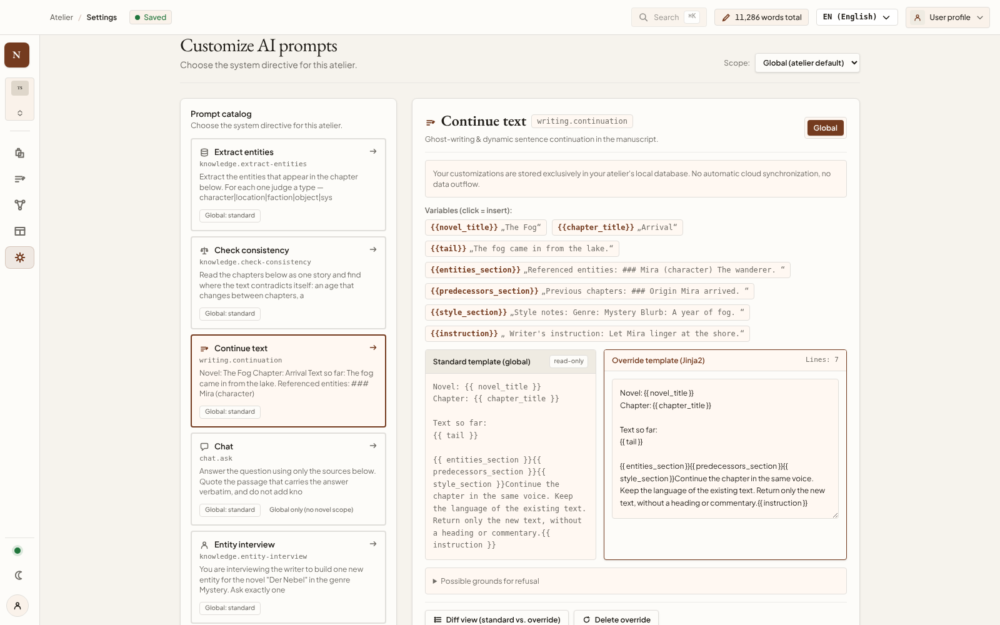
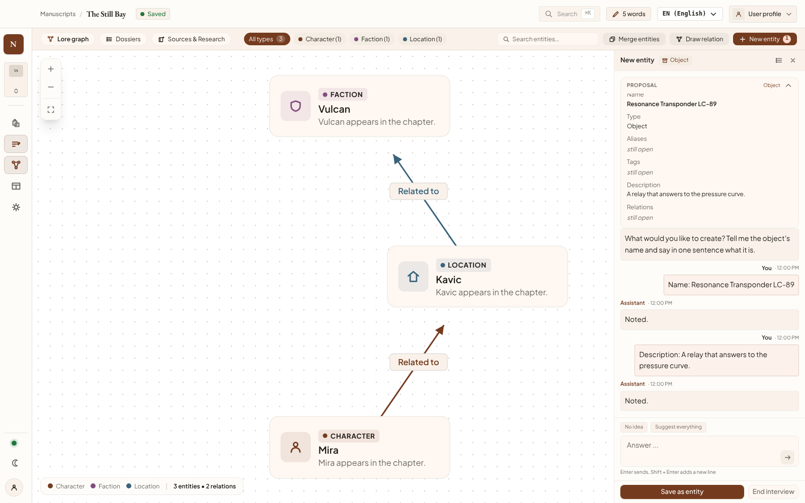

# Screenshot collection

These frames are captured from the running Narrare application. Dark frames show the reader's stored theme, not the operating system's.

Some frames use deterministic stand-ins at the model boundary: the dossiers frame shows extraction output from the fake extraction provider, the knowledge-dock frame shows a finding from the fake consistency provider, the AI-rules frame (29) shows the fake provider card, both interview frames (33 and 34) show stand-in replies, and the continuation frame uses the chat stand-in.

## Writing

### The rebuilt writing workspace

The scene-centric workspace with the explorer, editor and docks together

### The rebuilt writing workspace in dark

The same workspace in the reader's stored dark theme

### Zen mode

The prose alone, with the explorer and docks out of the way

### Zen mode in dark

The same uninterrupted prose in the reader's stored dark theme

### The workspace with a continuation

A chapter open in the scene editor and a grey continuation offered below the prose, with its Tab accept pill

### The bookshelf

Three novels with the latest-edited one offered for resuming

### The bookshelf in dark

The same shelf in the reader's stored dark theme

## Knowledge

### Dossiers

The novel's knowledge organized as dossiers with a character's dossier open

### Sources

The empty sources archive and its upload door

### The knowledge dock

A consistency finding and the novel's entities beside the prose

### The lore graph

The novel's canon as three named entities and two relations, with the selected node's dossier

### The lore graph in dark

The same canon, canvas and dossier in the reader's stored dark theme

## Planning

### Causality

The planned chain of cause and effect behind the story

### The timeline

The placed events in chronological order, with unordered drafts at the end

### The timeline in dark

The same events and labels in the reader's stored dark theme

### The storyboard

Chapters as cards in their structure's columns with their scene counts and statuses

### The storyboard in dark

The same columns, cards and statuses in the reader's stored dark theme

## Settings

### The welcome and setup screen

The first-run welcome: start a new work or choose a demo

### The settings hub

Language, appearance and the author profile

### AI rules

The configured provider card and the create-provider form

### Prompts

The prompt catalog beside the selected prompt's editor and template

## Assistant

### Create an entity

The manual entity dialog beside the lore graph

### Create an entity in dark

The same dialog in the reader's stored dark theme

### The entity interview

An answered interview and the proposal it built

### The entity interview in dark

The same conversation and proposal in the reader's stored dark theme
