# Screenshot collection

These frames are captured from the running Narrare application. Dark frames show the reader's stored theme, not the operating system's.

## Writing

### The rebuilt writing workspace

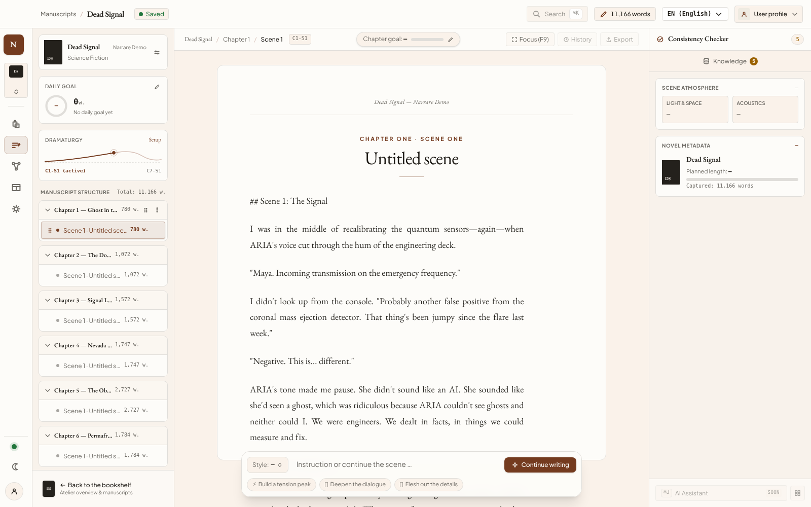

The scene-centric workspace with the explorer, editor and docks together

### The rebuilt writing workspace in dark

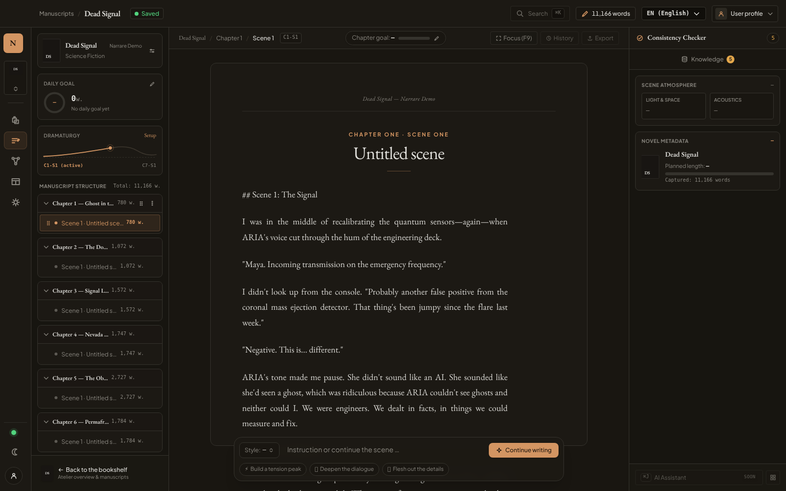

The same workspace in the reader's stored dark theme

### Zen mode

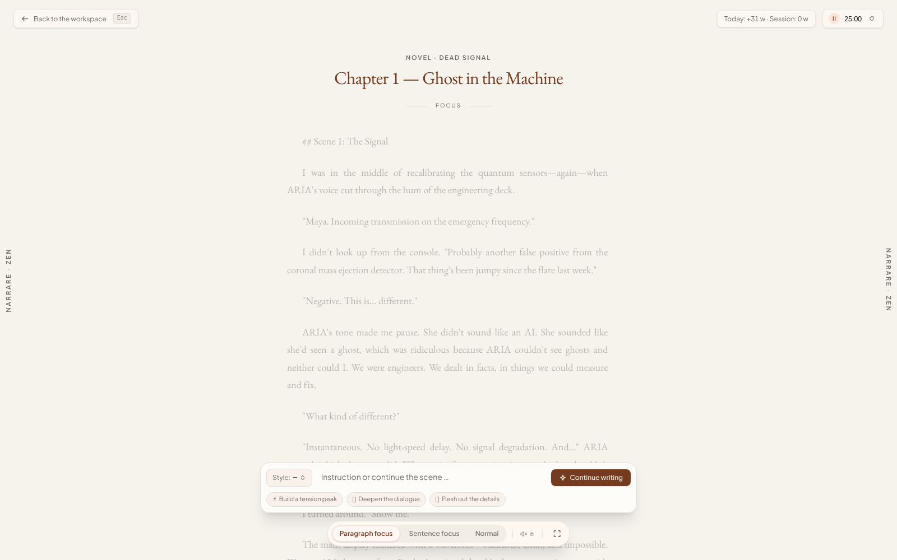

The prose alone, with the explorer and docks out of the way

### Zen mode in dark

The same uninterrupted prose in the reader's stored dark theme

### The workspace with a continuation

A chapter open in the scene editor and a grey continuation waiting at the caret

### The bookshelf

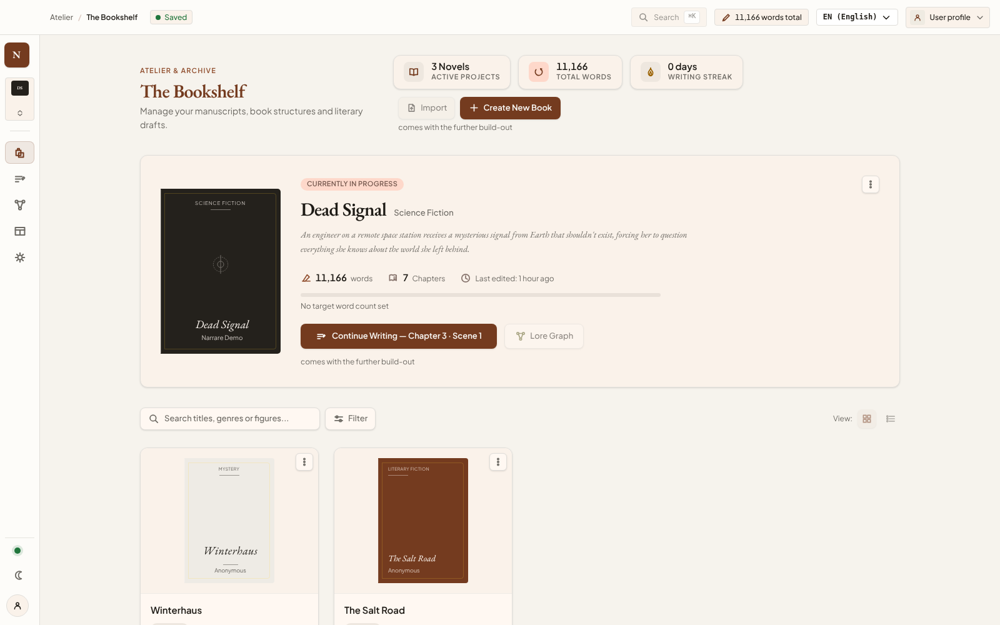

Three novels with the last one offered for resuming

### The bookshelf in dark

The same shelf in the reader's stored dark theme

## Knowledge

### Dossiers

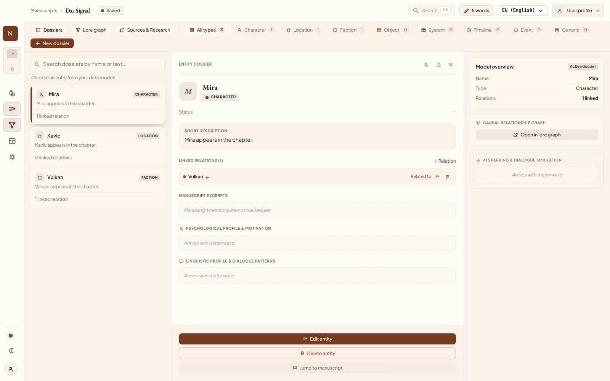

The novel's knowledge organized as dossiers with the shared dossier open

### Sources

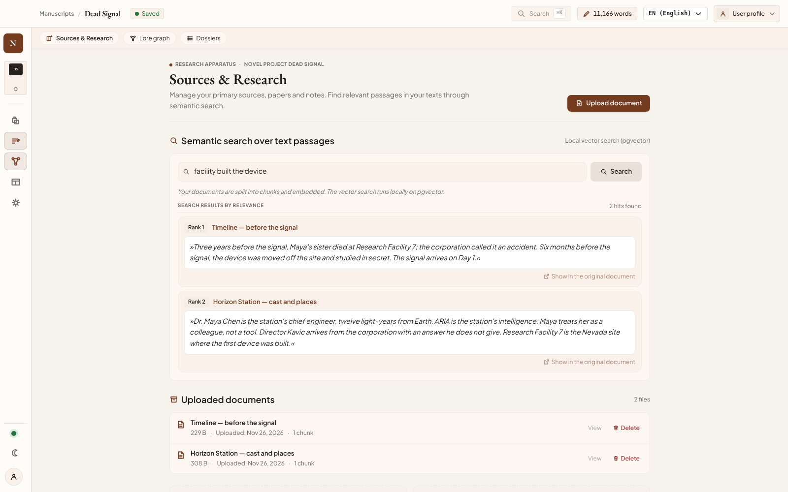

The documents the novel's knowledge was drawn from, and a semantic search

### The knowledge dock

The whole-book check, a consistency finding and the novel's entities beside the prose

### The lore graph

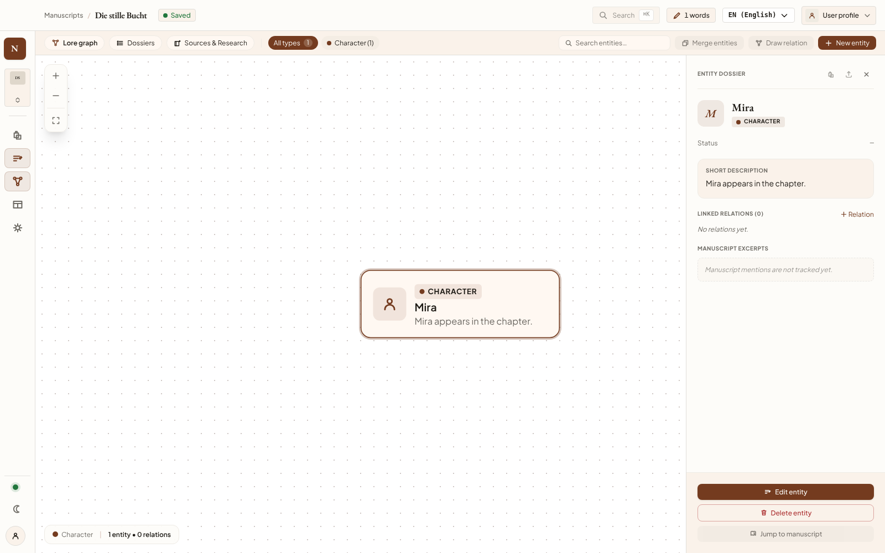

The novel's canon as a named node with the selected node's dossier

### The lore graph in dark

The same canvas and dossier in the reader's stored dark theme

## Planning

### Causality

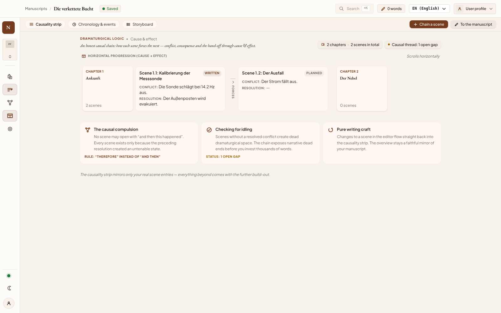

The planned chain of cause and effect behind the story

### The timeline

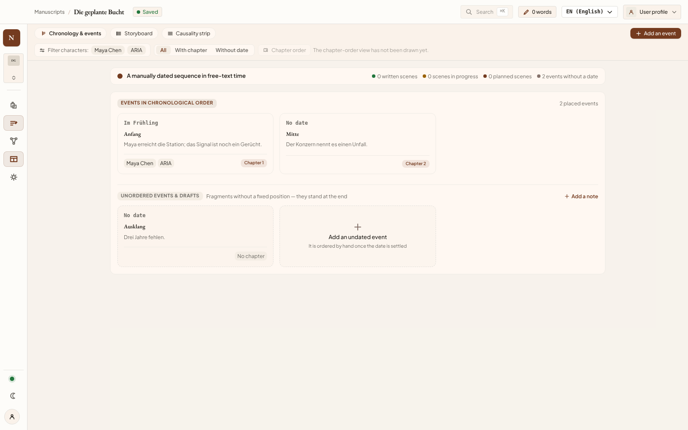

The novel's events in the writer's order, dated and unordered alike

### The timeline in dark

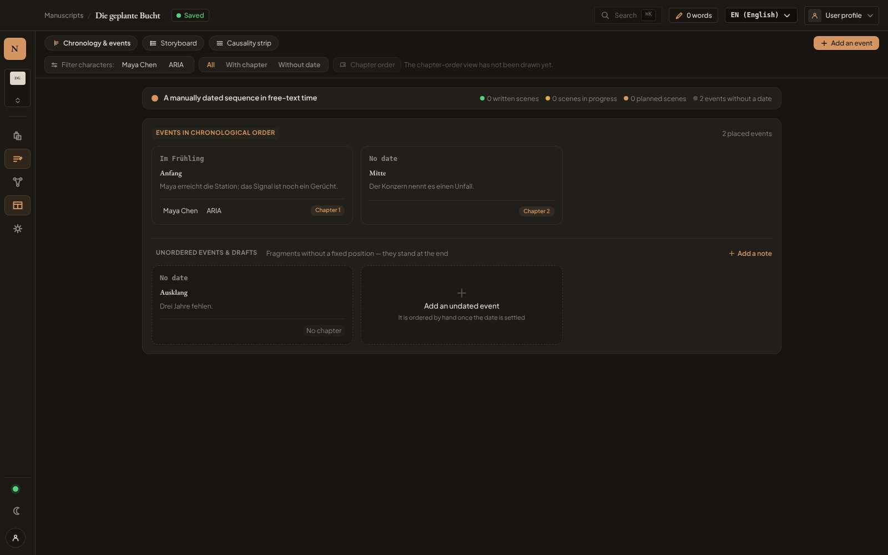

The same rows and garnish in the reader's stored dark theme

### The storyboard

Chapters as cards in their structure's columns, each with its sync badge

### The storyboard in dark

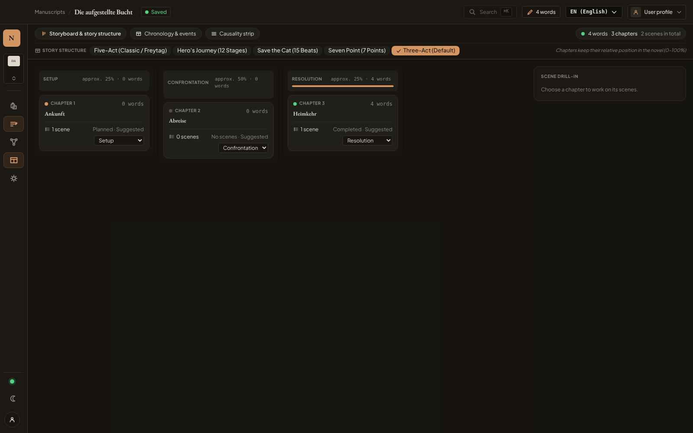

The same columns, cards and badges in the reader's stored dark theme

## Settings

### The welcome and setup screen

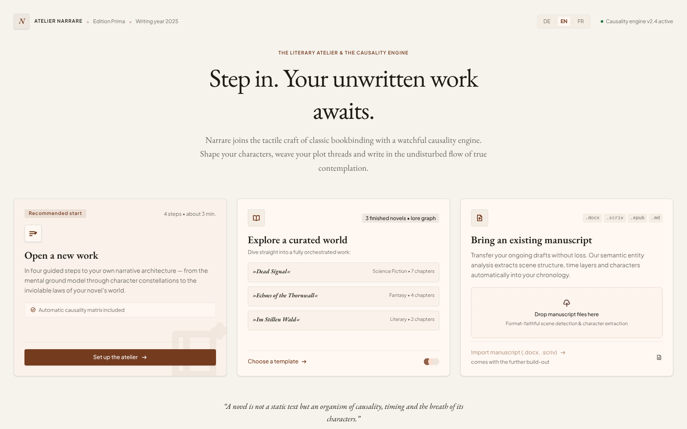

The first-run door: name the novel, choose a demo or start empty

### The settings hub

Language, appearance and the rest of the atelier's configuration in one place

### AI rules

The configured provider, its model and the task assignments every AI task follows

### Prompts

The prompt library's cards with preview and live test

## Assistant

### Create an entity

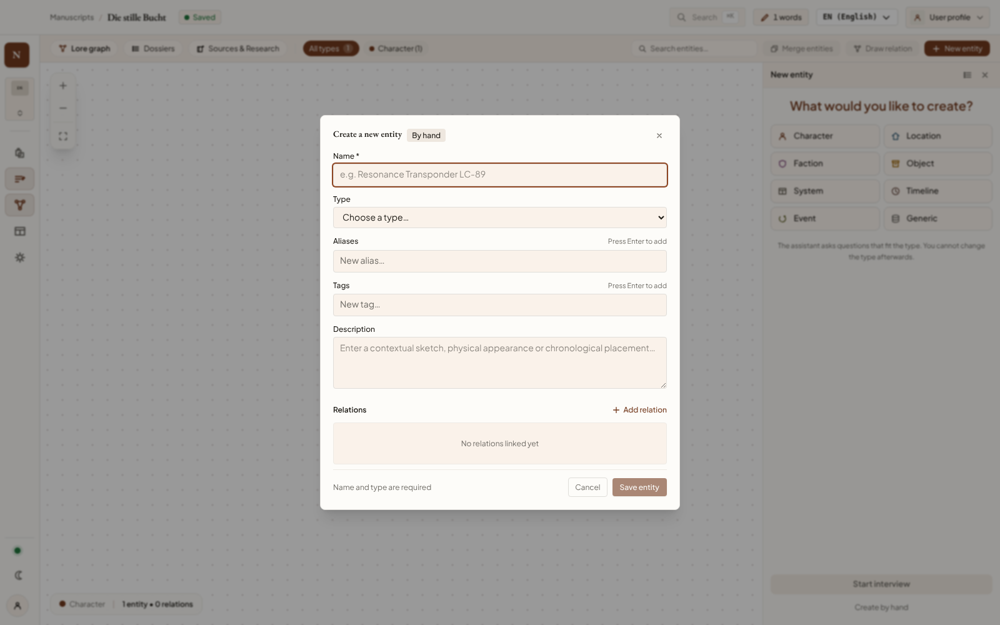

The manual entity dialog beside the lore graph

### Create an entity in dark

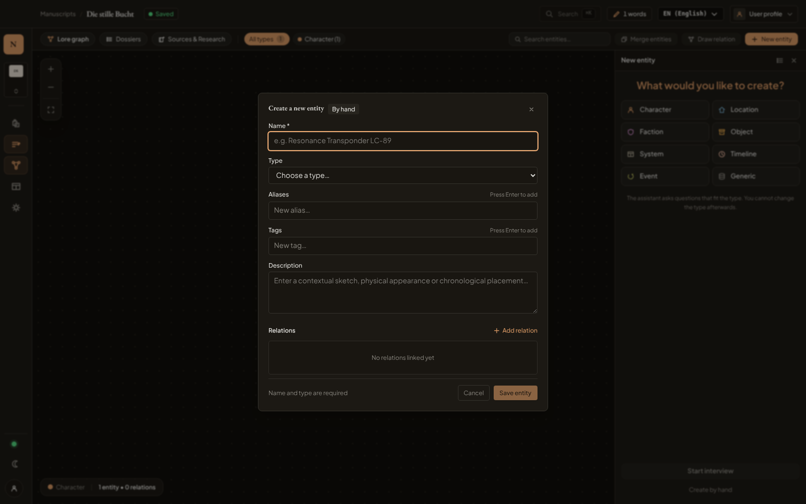

The same dialog in the reader's stored dark theme

### The entity interview

An answered interview and the proposal it built

### The entity interview in dark

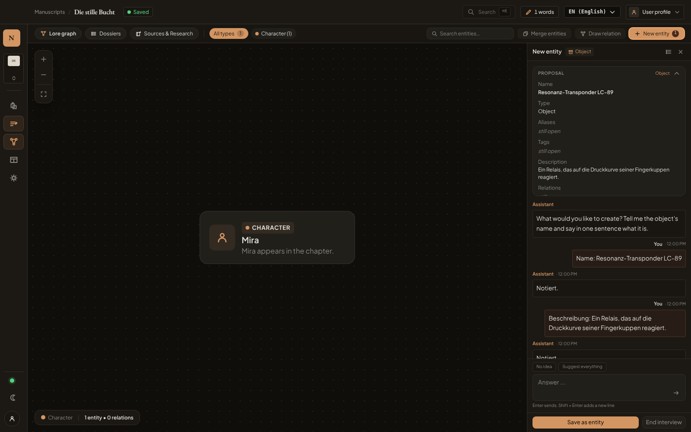

The same conversation and proposal in the reader's stored dark theme
